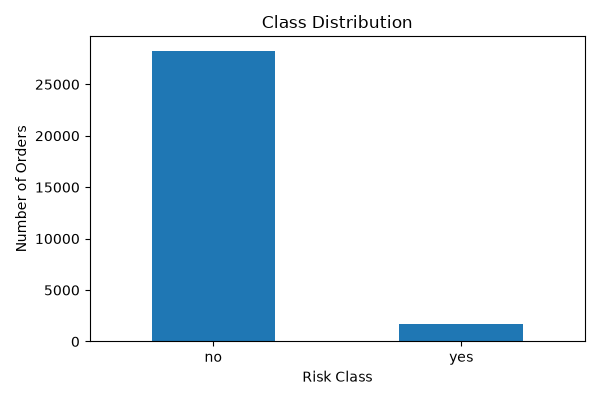
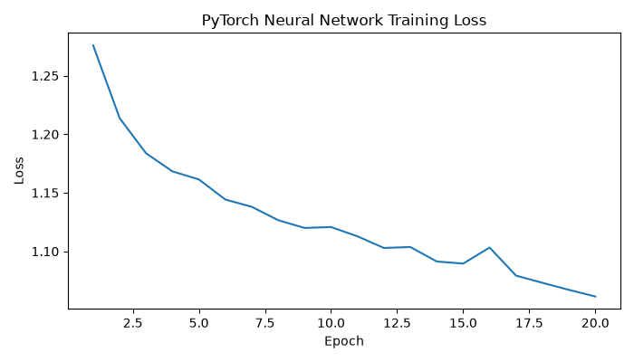
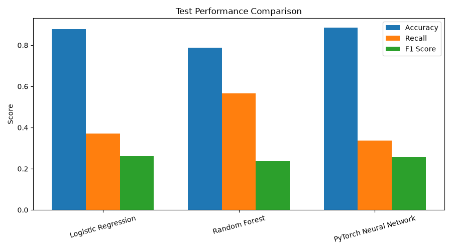
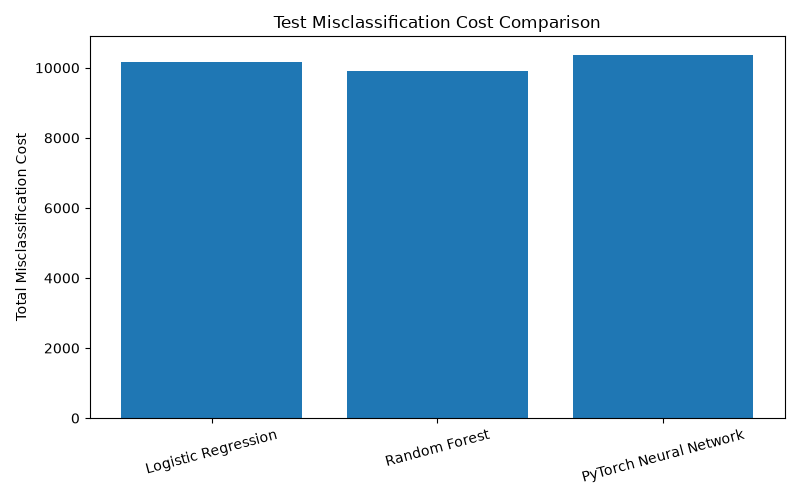
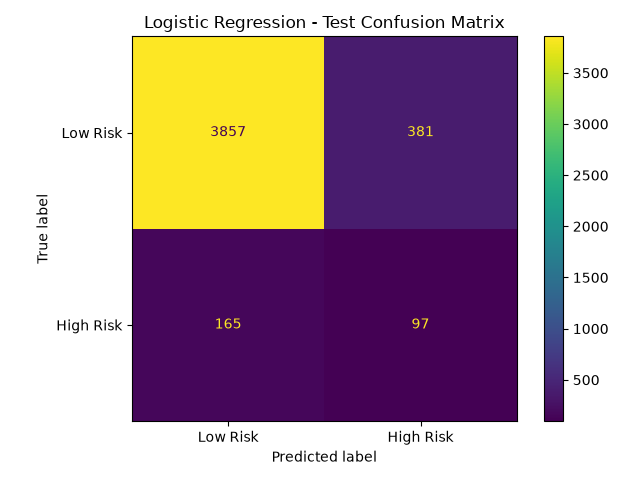
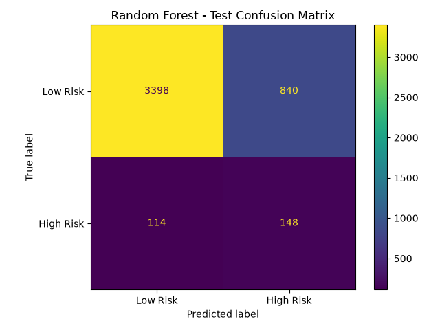
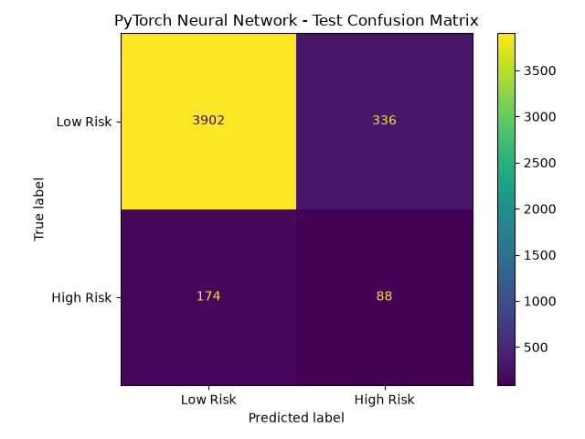

# Online Purchase Order Risk Prediction

Machine learning project for identifying high-risk online purchase orders using cost-sensitive classification.

The project compares Logistic Regression, Random Forest, and a PyTorch neural network while addressing class imbalance, feature preprocessing, threshold optimization, and unequal misclassification costs.

---

## Project Overview

Online purchase orders can contain different levels of transaction risk. The goal of this project is to predict whether an order should be classified as:

- **High Risk (`yes`)**
- **Low Risk (`no`)**

The dataset is highly imbalanced, with High Risk transactions representing only a small portion of all orders.

Because failing to detect a High Risk transaction can be more costly than incorrectly flagging a Low Risk transaction, the models are evaluated using both traditional classification metrics and a custom misclassification cost function.

---

## Dataset

The dataset contains:

- **30,000 purchase orders**
- **44 original attributes**
- **28,254 Low Risk transactions**
- **1,746 High Risk transactions**
- High Risk rate: **5.82%**

Two source files are used:

```text
data/
├── risk-attributes.txt
└── risk-dataset.txt
```

The dataset contains numerical, categorical, date/time, transaction, customer, payment, and historical order information.

---

## Technology Stack

| Category | Technologies |
|---|---|
| Programming | Python |
| Data Processing | Pandas, NumPy |
| Machine Learning | scikit-learn |
| Deep Learning | PyTorch |
| Visualization | Matplotlib |
| Development | Jupyter Notebook |
| Version Control | Git, GitHub |

---

## Data Preprocessing

The raw dataset required several preprocessing steps before model training.

The following transformations were applied:

- Removed `ORDER_ID` because it is an identifier
- Extracted numerical information from date and time attributes
- Removed original date/time columns after transformation
- Removed high-cardinality product identifier fields
- Handled missing numerical values using median imputation
- Handled missing categorical values using the most frequent category
- Applied one-hot encoding to categorical variables
- Standardized numerical variables

After feature engineering:

```text
Original dataset:     30,000 rows × 44 attributes
Model features:       38 features
Processed features:   68 model-ready inputs
```

---

## Class Imbalance

The target variable is highly imbalanced:

| Class | Transactions | Percentage |
|---|---:|---:|
| Low Risk | 28,254 | 94.18% |
| High Risk | 1,746 | 5.82% |



Because High Risk transactions are relatively rare, model accuracy alone would not provide a sufficient evaluation.

Class weighting and cost-sensitive evaluation are therefore used throughout the project.

---

## Train, Validation, and Test Split

The dataset is divided using stratified sampling:

- **70% Training:** 21,000 records
- **15% Validation:** 4,500 records
- **15% Testing:** 4,500 records

The validation dataset is used for model and threshold selection.

The test dataset is kept separate until final evaluation to reduce the risk of overfitting model decisions to the test set.

---

## Models

Three classification approaches were developed and compared.

### 1. Logistic Regression

Logistic Regression is used as the baseline model.

Class weighting is applied to account for the imbalanced target distribution.

Optimized validation threshold:

```text
Threshold: 0.68
Validation Cost: 9,705
```

### 2. Random Forest

Random Forest is used to capture nonlinear relationships between transaction attributes.

Class weighting is also applied.

Optimized validation threshold:

```text
Threshold: 0.08
Validation Cost: 9,775
```

### 3. PyTorch Neural Network

A feed-forward neural network was implemented using PyTorch.

Architecture:

```text
68 Input Features
        ↓
64 Neurons
        ↓
ReLU
        ↓
Dropout
        ↓
32 Neurons
        ↓
ReLU
        ↓
Dropout
        ↓
1 Output
```

Binary Cross Entropy with logits is used as the loss function.

A positive-class weight is applied to give greater importance to High Risk transactions.



Optimized validation threshold:

```text
Threshold: 0.74
Validation Cost: 9,925
```

---

## Cost-Sensitive Evaluation

Traditional accuracy is not sufficient for this problem because different prediction errors have different business consequences.

The project uses the following cost assumptions:

| Prediction Error | Cost |
|---|---:|
| High Risk predicted as Low Risk | 50 |
| Low Risk predicted as High Risk | 5 |

The total cost is calculated as:

```text
Total Cost =
(False Negatives × 50)
+
(False Positives × 5)
```

This places significantly greater importance on identifying High Risk transactions.

---

## Model Results

### Test Set Performance

| Model | Accuracy | Precision | Recall | F1 Score | False Positives | False Negatives | Test Cost |
|---|---:|---:|---:|---:|---:|---:|---:|
| Logistic Regression | 87.87% | 20.29% | 37.02% | 26.22% | 381 | 165 | 10,155 |
| Random Forest | 78.80% | 14.98% | **56.49%** | 23.68% | 840 | **114** | **9,900** |
| PyTorch Neural Network | **88.67%** | **20.75%** | 33.59% | 25.66% | **336** | 174 | 10,380 |



---

## Misclassification Cost Comparison

The models are also compared using business-oriented misclassification cost.



The Random Forest achieved the lowest cost on the final test dataset.

However, the final model was not selected using test performance.

---

## Final Model Selection

Model selection was performed using the validation dataset.

| Model | Validation Cost | Threshold |
|---|---:|---:|
| Logistic Regression | **9,705** | 0.68 |
| Random Forest | 9,775 | 0.08 |
| PyTorch Neural Network | 9,925 | 0.74 |

Based on validation misclassification cost, the selected final model was:

## Logistic Regression

The independent test dataset was then used only for final evaluation.

This distinction is important because selecting a model based directly on test performance could introduce test-set leakage and produce an overly optimistic estimate of model performance.

---

## Confusion Matrices

### Logistic Regression



### Random Forest



### PyTorch Neural Network



---

## Key Findings

- The dataset is strongly imbalanced, with only **5.82% High Risk transactions**.
- Accuracy alone can be misleading for imbalanced classification problems.
- Threshold tuning significantly affects the trade-off between false positives and false negatives.
- Random Forest achieved the highest High Risk recall on the test set.
- Logistic Regression produced the lowest validation misclassification cost.
- The test dataset should be used for final evaluation rather than model selection.
- Business-oriented cost functions can lead to different model decisions than accuracy alone.

---

## Project Structure

```text
Online-Purchase-Order-Risk-Prediction/
│
├── README.md
├── requirements.txt
├── .gitignore
│
├── data/
│   ├── risk-attributes.txt
│   └── risk-dataset.txt
│
├── notebooks/
│   └── purchase_order_risk_prediction.ipynb
│
└── outputs/
    ├── class_distribution.png
    ├── cost_comparison.png
    ├── logistic_regression_confusion_matrix.png
    ├── model_performance_comparison.png
    ├── model_results.csv
    ├── neural_network_training_loss.png
    ├── pytorch_neural_network_confusion_matrix.png
    └── random_forest_confusion_matrix.png
```

---

## Running the Project

Clone the repository:

```bash
git clone https://github.com/Hanpin-com/Online-Purchase-Order-Risk-Prediction.git
cd Online-Purchase-Order-Risk-Prediction
```

Install the required packages:

```bash
pip install -r requirements.txt
```

Start Jupyter Notebook:

```bash
jupyter notebook
```

Open:

```text
notebooks/purchase_order_risk_prediction.ipynb
```

---

## Skills Demonstrated

This project demonstrates practical experience with:

- Data preprocessing
- Exploratory data analysis
- Missing-value handling
- Feature engineering
- Categorical encoding
- Feature scaling
- Imbalanced classification
- Logistic Regression
- Random Forest
- PyTorch neural networks
- Threshold optimization
- Cost-sensitive machine learning
- Confusion matrix analysis
- Model validation
- Model comparison
- Business-oriented model evaluation

---

## Portfolio Context

This project was originally developed from an Artificial Intelligence course final project and was later reorganized and refined into a portfolio project.

The portfolio version focuses on presenting the machine learning workflow, model evaluation methodology, and business implications in a clear and reproducible format.

``` text
Author: HAN-PIN, HUNG
```